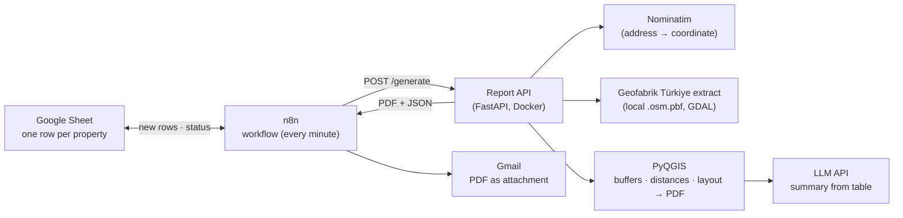

# Property Location Report Generator

Add an address or a coordinate in Türkiye as a row in a Google Sheet, get back a one-page
PDF location report by email: a map with 500 m / 1 km radius rings, nearby amenities by category,
straight-line distances to the nearest of each, and a short AI-written summary that sticks
to the numbers.

Built with **headless QGIS (PyQGIS)**, **OpenStreetMap** data, **FastAPI** and **n8n**,
all running locally in Docker.

**Coverage: Türkiye only.** Locations outside Türkiye are rejected with a clear error.


Sample PDFs: [Kaş (coastal town)](samples/output/kas.pdf) ·
[Kaleiçi, Antalya (city centre)](samples/output/kaleici.pdf) ·
[Elmalı (rural)](samples/output/elmali.pdf)

## Who it is for

Short-term rental hosts, property managers, real-estate agencies and investors who need a
quick, consistent answer to "what is around this property?" for a listing, a client or an
investment memo, without opening a GIS application.

## What the report contains

- **Map:** OpenStreetMap basemap, the property, 500 m and 1 km radius rings, and amenities
  coloured by category, with legend, scale bar and north arrow.
- **Distance table:** for beach, supermarket, restaurant, cafe, pharmacy and bus stop, the
  number within 500 m and within 1 km, and the straight-line distance to the nearest one.
- **Location summary:** 3–4 sentences written by an LLM **from the table only**. The model gets
  nothing else, so it cannot invent facts, and the PDF labels the text as AI-generated.
- **Source note:** "© OpenStreetMap contributors" and the date of the OSM data used.

Each run also writes `analysis.gpkg` (all layers, for QGIS), `summary.json` (the table as data)
and `pois.geojson`.

## How it works



1. **Input:** a row in a Google Sheet with an address (geocoded with Nominatim) or a
   latitude/longitude, plus a recipient email.
2. **Coverage check:** anything outside Türkiye stops here with a clear error.
3. **POIs:** read from a local copy of the Geofabrik Türkiye extract with GDAL's OSM driver.
   Both points and areas are used; an area (a beach, a supermarket building) stays a polygon
   and its distance is measured to the nearest edge.
4. **Analysis (PyQGIS):** the property is projected to its local **UTM zone** (chosen
   automatically from the coordinate) so that buffers and distances are in metres, never
   in degrees. Amenities are counted per ring and the nearest one per category is found.
5. **Layout:** layer styles (`.qml`) and a print layout template (`.qpt`) produce an A4 PDF.
6. **Summary:** the table is sent to an OpenAI-compatible LLM; if that fails the PDF is still produced.
7. **Delivery:** n8n emails the PDF as an attachment and writes the result into the same row.

## Tech stack

| Layer | Choice |
|---|---|
| GIS engine | QGIS 3.44 / PyQGIS, headless (`QT_QPA_PLATFORM=offscreen`) |
| Container | Based on the official `qgis/qgis` Docker image (includes GDAL with the OSM driver) |
| POI data | Geofabrik Türkiye extract (`turkey-latest.osm.pbf`), read locally |
| Geocoding | Nominatim (max 1 request/s, cached, identifying User-Agent) |
| Report API | FastAPI + uvicorn |
| Orchestration | n8n (Google Sheet input, HTTP request, Gmail) |
| AI summary | Any OpenAI-compatible chat API (tested with Groq) |
| Output | PDF, GeoPackage, JSON |

## Quick start

Requirements: Windows/macOS/Linux with Docker Desktop, about 5 GB of free disk space
(Docker image ~3.7 GB, OSM extract ~0.65 GB).
Commands below are for PowerShell.

```powershell
# 1. Download the OSM extract once (~620 MB, MD5-verified) -> data\turkey-latest.osm.pbf
.\scripts\download_extract.ps1

# 2. Settings: Nominatim User-Agent and LLM key (optional; without a key the PDF says
#    "AI summary unavailable.")
Copy-Item .env.example .env

# 3. Build and start the report API on http://localhost:8000
docker compose up -d --build
Invoke-RestMethod http://localhost:8000/health

# 4. Generate a report
Invoke-RestMethod -Method Post -Uri http://localhost:8000/generate -ContentType "application/json" `
  -Body '{"lat": 36.2018, "lon": 29.6377, "name": "Kas Harbour Villa"}'
```

Files are written to `out\<job>\`. The same pipeline runs from the command line:

```powershell
docker compose run --rm qgis python3 generate_report.py --address "Kaleici, Antalya" --name "Old Town Apartment" --out /out/kaleici
```

**Full setup with n8n, Google Sheet and Gmail:** step-by-step guide in
[docs/DEPLOYMENT.md](docs/DEPLOYMENT.md) (about 30–45 minutes, mostly the one-time Google setup).
n8n can run from this project: `docker compose --profile n8n up -d`.

## OSM data (Geofabrik extract)

All amenities in the report come from one file on your disk: the **Türkiye extract** of
OpenStreetMap published by [Geofabrik](https://download.geofabrik.de/). It is not in the
repository (about 620 MB) and not in the Docker image; you download it once and the container
reads it from `data\`.

**Where to find it:** [download.geofabrik.de/europe/turkey.html](https://download.geofabrik.de/europe/turkey.html)
→ the `.osm.pbf` file, `turkey-latest.osm.pbf`
(direct link: `https://download.geofabrik.de/europe/turkey-latest.osm.pbf`).
Geofabrik rebuilds it daily from OpenStreetMap; the page shows the date of the current file.
Use the `.osm.pbf` file; the other formats on that page are not used.

**Option A: download script (recommended, Windows PowerShell)**

```powershell
.\scripts\download_extract.ps1
```

It downloads the file to `data\turkey-latest.osm.pbf`, checks it against Geofabrik's MD5
checksum (a broken download is deleted, not used) and saves the file date to
`data\turkey-latest.osm.pbf.timestamp`. If the file already exists it does nothing.

**Option B: manual download (any OS)**

1. Download `turkey-latest.osm.pbf` and `turkey-latest.osm.pbf.md5` from the page above.
2. Compare checksums: the hash must match the first value in the `.md5` file.
   - Windows: `Get-FileHash .\turkey-latest.osm.pbf -Algorithm MD5`
   - macOS: `md5 turkey-latest.osm.pbf` · Linux: `md5sum turkey-latest.osm.pbf`
3. Put the file in the `data` folder of the repository, with exactly this name:

```
qgis-property-report/
└── data/
    └── turkey-latest.osm.pbf
```

**How the container finds it:** `docker-compose.yml` mounts `./data` read-only at `/data` and
sets `OSM_PBF_PATH=/data/turkey-latest.osm.pbf`. To use another folder or file name, change the
`./data` volume or `OSM_PBF_PATH` in `docker-compose.yml` (a value in `.env` is overridden by
the compose file).

**Check that it is deployed:**

```powershell
Invoke-RestMethod http://localhost:8000/health
# {"status":"ok","osm_extract":{"path":"/data/turkey-latest.osm.pbf","ok":true,"size_mb":654}}
```

If the file is missing, `/health` and every report request return `503 extract_unavailable`
instead of starting a report.

**Update to newer OSM data:**

```powershell
.\scripts\download_extract.ps1 -Force
```

No rebuild or restart is needed: each report opens the file again, so the next report uses the
new data. The script downloads to a temporary `.part` file and replaces the old one only after
the checksum matches. Each report's source note shows the OSM data date of the file it used
(read from the file header, or from the `.timestamp` file).

**Other regions:** coverage is Türkiye only by design. Geofabrik has extracts for other
countries, but the coverage check rejects locations outside Türkiye, so swapping the file alone
is not enough.

## Report API

`POST /generate` takes either an address or a coordinate; `name` is optional.

```powershell
# By coordinates
Invoke-RestMethod -Method Post -Uri http://localhost:8000/generate -ContentType "application/json" `
  -Body '{"lat": 36.2018, "lon": 29.6377, "name": "Kas Harbour Villa"}'

# By address (geocoded with Nominatim)
Invoke-RestMethod -Method Post -Uri http://localhost:8000/generate -ContentType "application/json" `
  -Body '{"address": "Kaleici, Antalya", "name": "Old Town Apartment"}'
```

Success (`200`) returns `job`, `pdf_url`, `summary_url` and the list of output files.
`GET /files/{job}/{name}` downloads a file; `GET /health` also checks that the OSM extract is present.

Every error has the same shape, so callers can branch on `error_code`:

```json
{"status": "error", "job": "20261115-...", "error_code": "outside_coverage",
 "error": "Location 37.98, 23.73 is outside Türkiye. Coverage: Türkiye only."}
```

| HTTP | `error_code` | Meaning |
|---|---|---|
| 422 | `invalid_input` | Missing/invalid fields, malformed JSON, both `address` and `lat`/`lon` given; sheet: missing or invalid `email` |
| 422 | `outside_coverage` | Location or address is outside Türkiye |
| 422 | `address_not_found` | Nominatim found no match for the address |
| 422 | `no_osm_data` | No OSM data around the point (e.g. at sea); never reported as "0 POIs" |
| 502 | `geocoding_unavailable` | Nominatim unreachable or returned an error (retry later) |
| 502 | `delivery_failed` | Sheet only: the report was generated but the email could not be sent |
| 503 | `extract_unavailable` | OSM extract missing or unreadable (deployment problem) |
| 503 | `service_unreachable` | Sheet only: the report API is not running |
| 504 | `timeout` | Report generation exceeded `REPORT_TIMEOUT_S` (default 540 s) |
| 500 | `processing_error` | Unexpected failure; the response includes `stderr_tail` for debugging |

4xx errors are input problems (fix the request or row); 5xx errors are service problems (retry or check the deployment).
In the Google Sheet the same `error_code` is written to the row.

## Google Sheet input

Add a row to a Google Sheet and the report arrives by email. Several rows at once work too; they are processed one after another.

| address | lat | lon | name | email | status | error_code | report_id | message | processed_at |
|---|---|---|---|---|---|---|---|---|---|
| Kaleici, Antalya | | | Old Town Apartment | client@example.com | sent | | 20261115-… | Emailed to client@example.com | 2026-11-15 14:02:11 |
| | 36.2018 | 29.6377 | Kas Harbour Villa | client@example.com | | | | | |
| Acropolis, Athens | | | | client@example.com | error | outside_coverage | 20261115-… | … is not in Türkiye … | 2026-11-15 14:02:40 |

- Fill in **either** `address` **or** `lat` + `lon` (if both are filled, the coordinates are used),
  plus `email`; `name` is optional. Decimal commas (`36,2018`) are accepted.
- Addresses are geocoded with OpenStreetMap, where Turkish street addresses and house numbers
  are often incomplete. Include the district and city (`Esenyurt Sokak 18, Maltepe, İstanbul`)
  and leave out flat numbers; if a row ends with `address_not_found`, use `lat` + `lon` instead
  (in Google Maps, right-click the building to copy its coordinates).
- For an exact property location, prefer `lat` + `lon`. A partial address can match a place with
  the same name elsewhere (e.g. `Paşa Mahallesi, Akhisar` resolves to Sakarya, not Manisa), and the
  report is then produced for the wrong location without an error.
- Leave the last five columns empty; the workflow fills them in. `status` goes
  *(empty)* → `processing` → `sent` or `error`, and `error_code` uses the same codes as the API.
- To run a row again, clear its `status` cell.
- The sheet is checked once a minute, so a report arrives about 1–2 minutes after the row is added.

Setup in short (details, Google OAuth and troubleshooting: [docs/DEPLOYMENT.md](docs/DEPLOYMENT.md)):

1. Create a Google Sheet with the header row from [`samples/sheet_template.csv`](samples/sheet_template.csv)
   (or import the file: *File → Import*).
2. Import `n8n/workflow.json` into n8n.
3. In the **Config** node, paste the sheet URL and the tab name.
4. Select a Google Sheets OAuth2 credential in **Read Rows**, **Mark Processing** and **Write Result**,
   and a Gmail credential in **Send Email**; then publish the workflow.

## LLM settings (AI location summary)

The model only receives the analysis table (category counts, nearest straight-line distances
and POI names from `summary.json`) and is instructed not to add any information that is not in it.

Any OpenAI-compatible chat-completions API can be used. Configure it in `.env`
(copy `.env.example`):

| Variable | Example | Notes |
|---|---|---|
| `LLM_PROVIDER` | `groq` | Label; `groq` also provides defaults for the two settings below |
| `LLM_MODEL` | `openai/gpt-oss-120b` | Model id at the provider |
| `LLM_BASE_URL` | `https://api.groq.com/openai/v1` | OpenAI-compatible endpoint |
| `LLM_API_KEY` | – | Required; never commit it (`.env` is git-ignored) |

Only Groq has been tested so far. Behaviour:

- Temperature 0.2. HTTP 429 is retried up to 3 times with backoff (honours `Retry-After`).
- If the key is missing or the call fails, the PDF is still produced and the summary reads
  "AI summary unavailable."; the reason is written to `ai_summary.json`.
- `--no-summary` skips the LLM call entirely.

## Data sources and limitations

- Map data and basemap © OpenStreetMap contributors (ODbL).
- POIs are read from a local copy of the [Geofabrik Türkiye extract](https://download.geofabrik.de/europe/turkey.html).
  No third-party POI API is called, so POI lookup works offline. The extract is not part of the
  repository; see [OSM data (Geofabrik extract)](#osm-data-geofabrik-extract) for download,
  deployment and updates.
- The OSM data date of the extract is shown in every report's source note.
  Bundled samples (`samples/poi/`, `samples/output/`) use OSM data of 2026-11-12.
  Re-run the download script to refresh the data.
- One POI lookup scans the whole extract: about 8–10 s; a full report takes about 15–20 s
  including the LLM call.
- Results depend on OpenStreetMap tagging quality: a place is counted in the category it is
  tagged with in OSM, and missing places are missing from the report.
- A location with no OSM data around it (outside the extract, or at sea) is reported as an error,
  never as "0 POIs".
- Distances are straight-line, not walking routes.

## Project structure

```
qgis/
  generate_report.py     # CLI: location -> PDF + GeoPackage + JSON
  server.py              # Report API (FastAPI)
  report/
    poi_provider.py      # POIs from the local OSM extract (GDAL OSM driver)
    osm.py               # Nominatim geocoding (cache, rate limit, coverage check)
    crs.py               # UTM zone selection, Türkiye check
    analysis.py          # buffers, counts, nearest distances (metric CRS)
    render.py            # QGIS project, layout, PDF export
    llm.py               # AI summary from summary.json
  styles/  templates/    # .qml layer styles, .qpt print layout
  tests/                 # unit tests (small OSM fixture; LLM client mocked)
n8n/workflow.json        # Google Sheet rows -> report API -> Gmail -> status back to the row
docs/DEPLOYMENT.md       # step-by-step setup of the whole system (n8n, Google OAuth, Sheet)
scripts/download_extract.ps1
samples/                 # sample POI files and PDFs (no extract needed to view them)
```

## Tests

```powershell
docker compose run --rm qgis python3 -m unittest discover -s tests -v
```

POI tests read a small hand-made OSM file through the real GDAL driver; tests against the
real extract are skipped when it is not present. LLM tests mock the API client (no network).

## License

Code: [MIT](LICENSE). Map data and the bundled samples (`samples/poi/`, `samples/output/`,
`docs/images/`) contain OpenStreetMap data © OpenStreetMap contributors, available under the
[Open Database License (ODbL)](https://www.openstreetmap.org/copyright).
